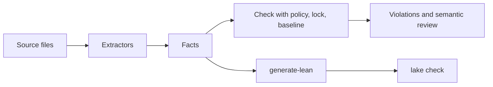

# Lintel

Lintel stops architecture rules from eroding while humans and AI agents edit a codebase. It turns those rules into facts a program can check, runs the same check in hooks and CI, and requires a recorded decision for exceptions.

## Why

Generated edits are fast and local. An agent can add an import that works, passes tests, and still moves outside code into the center of the app:

```python
# core/pricing.py
from adapters.config import load_config  # core now depends on the outside world
```

Tests still pass, but the change cost grows: core can no longer be reasoned about without the config stack, and later agents copy the pattern.

The inward rule prevents this. Put facts, rules, and use cases in **core**. Put files, processes, HTTP, databases, frameworks, and CLI handling in **adapters**. Let **entrypoints** wire them together. Dependencies point inward: entrypoints and adapters may use core; core does not import them. When core needs I/O, it calls an interface it owns, and an adapter implements it.

Lintel makes that rule enforceable. It extracts source facts, checks them against a readable policy, separates new violations from recorded debt, and sends ambiguous cases to explicit semantic review. Hooks catch drift at edit time, `lintel check` gives the same result locally and in CI, `lintel.lock` catches silent rule changes, and every accepted exception carries a stable ID and a reason. A Lean model proves the deterministic part of the check over the extracted facts.

If you know Clean, Hexagonal, or Onion architecture, this is their shared dependency rule; they differ mainly in vocabulary. [docs/philosophy.md](docs/philosophy.md) compares them.


Solid arrows show source dependencies. The dashed arrow shows a call through an interface, not a source import.

For agents, that turns "keep the architecture clean" into concrete commands and machine-readable findings. Architecture intent survives long sequences of autonomous edits.

## Formal Lean spec

`lintel/Lintel.lean` is a Lean 4 model of inward dependency boundaries. It proves deterministic properties over extracted facts; `generate-lean` instantiates those facts and checks the generated module with Lean.

The theorem catalog, model definitions, and generation details are in [docs/formal-spec.md](docs/formal-spec.md).

`generate-lean` turns extracted facts into Lean predicates. The generated
instance closes the same rule with a proof:

```lean
theorem generated_core_cannot_reach_outer {a b : GeneratedModule}
    (ha : generatedCore a) (hb : ¬ generatedCore b) :
    ¬ Path generatedDep a b :=
  core_cannot_reach_outer generatedArchitecture ha hb
```

Trust boundary: generated Lean proves deterministic fact/policy checks only. Extraction completeness, runtime behavior, semantic judgment, typed capability choices, strict layering, and runtime/nested subsystem embeddings are not claimed as Lean theorems. `generatedNestedArchitecture` is an identity-embedding sanity instance, not a claim about repository subsystems. Scope coverage includes all scoped paths, including documentation and configuration files, not only source modules. See [docs/limitations.md](docs/limitations.md).

Toolchain: Lean 4.36.0, pinned in `lintel/lean-toolchain`.

Requires `lake` on `PATH`. Verify with:

```sh
cd lintel && lake build
```

CI runs both `lake build` and the Python checker pipeline on pushes and pull requests.

## Extractors and checker

`lintel/cli/extract_*.py` are CLI entrypoints. They call the extractor libraries in `lintel/adapters/*_extractor.py`, which scan a project root and emit JSON facts:



- `modules`: `{name, path, package?}` entries.
- `dependencies`: `{from, to, kind, source, line}` entries.

For the import under **Why**, the fact set carries an edge, not a judgment:

```json
{
  "modules": [
    {"name": "lintel.core.pricing", "path": "core/pricing.py"}
  ],
  "dependencies": [
    {
      "from": "lintel.core.pricing",
      "to": "lintel.adapters.config",
      "kind": "import",
      "source": "core/pricing.py",
      "line": 2
    }
  ]
}
```

The `core_outward` rule compares that edge with `[layers.core].allowed`.

| Finding | Meaning |
| --- | --- |
| `core_outward` | A core module depends on a non-core module. |
| `forbidden_import` | A core module imports a forbidden target. |
| `edge_not_allowed` | A source region has no permission for the target region. |
| `cycle` | A module dependency cycle. |
| `unparsed_source` | Declared source could not be parsed or has no analyzer. |
| `semantic_review` | Detectable ambiguity needs a judge or human review. |

| Concept | Configuration | Role |
| --- | --- | --- |
| Layers | `[layers.*]` | Inward rings; shell-style `fnmatch`, sorted by `priority`, first match wins. `core = true` maps to `Core` in the Lean model. |
| Default layer | `default_layer` | Unowned fallback for dependencies with no matching layer. |
| Scopes | `[scopes.*]` | Test, example, fixture, generated, and vendor contexts—not architectural layers. |
| Executables | `[[executables]]` | CLI surfaces with an owning layer. |
| Source suffixes | `[analysis] source_suffixes` | Governed source files; undeclared or unsupported suffixes fail closed. |

`ports` and `core` are core; `platform` covers language runtime primitives; `entrypoints`, `adapters`, and `infrastructure` are outer rings. Ports are contracts and boundary data owned by core. `tests/fixtures/policy.json` is an example JSON policy covering Rust, Go, and TypeScript module names.

Exception rules are formalized in [ESCAPE_HATCHES.md](ESCAPE_HATCHES.md). See
[Deterministic vs semantic findings](#deterministic-vs-semantic-findings) for
examples, [Semantic scenarios and decision model](#semantic-scenarios-and-decision-model)
for the overview, [SEMANTIC_SCENARIOS.md](SEMANTIC_SCENARIOS.md) for the
detailed catalog, [docs/semantic-decisions.md](docs/semantic-decisions.md) for
the model contract, [docs/limitations.md](docs/limitations.md) for status, and
[Glossary](#glossary) for terminology.

## Deterministic vs semantic findings

Lintel asks two questions: **can source syntax settle this?** and, if not,
**what is the intent behind valid syntax?** Deterministic checks answer the
first from declared imports, literals, and known framework calls. Semantic
checks ask the second when facts cannot prove intent, such as a rebound alias
or an undeclared decorator. Both produce findings, but only deterministic
findings can be decided without judgment.

The import under **Why** is deterministic: the module is in `core`, the target
is in `adapters`, and `[layers.core].allowed` permits only `ports`, `core`, and
`platform`. Result: `core_outward`.

The same boundary-shaped use can be ambiguous:

```python
# adapters/sample.py
import os as s
s = factory()       # s is rebound from an unknown expression
value = s.environ
```

`s` started as `os`, but `factory()` could return anything. Calling this
`os.environ` would be a guess; staying silent could hide an environment leak.
Result: one `semantic_review` with reason
`unresolved alias 's' may expose boundary state`.

These are the cases the decision model handles.
[SEMANTIC_SCENARIOS.md](SEMANTIC_SCENARIOS.md) catalogs the full set; the next
section walks through one.

## Semantic scenarios and decision model

[SEMANTIC_SCENARIOS.md](SEMANTIC_SCENARIOS.md) catalogs the constructs that
produce `semantic_review`. This section shows what happens to one of those
findings.

### How a decision is made

1. `lintel check` extracts facts, runs deterministic rules, and gathers the
   `semantic_review` findings.
2. For each finding, a semantic evaluator sees bounded context: rule, module,
   source line, reason, nearby source, and relevant policy facts. It cannot
   change facts or policy.
3. The evaluator chooses `compliant`, `violating`, or `needs-human-review`.
   Missing evidence means `needs-human-review`; low confidence is downgraded
   to `needs-human-review` rather than treated as acceptance.
4. The result is a proposal. `lintel check` reports it beside the still-open
   finding; no baseline or lock is written. A human decision commits later.

### Example: an unknown CLI decorator

```python
# adapters/commands.py
from acme_cli import app

@app.group()
def serve():
    ...
```

A deterministic rule can prove that `click.command()` parses argv because
`click` is enumerated. `acme_cli` is not. Calling `@app.group()` compliant or
violating from syntax alone would be a guess, so the analyzer emits:

```text
semantic_review: unresolved CLI framework decorator may parse argv (adapters/commands.py:3)
```

The evaluator applies the policy to the bounded evidence:

- If `adapters/commands.py` is a declared executable owned by `adapters`, the
  decorator is adapter-local CLI wiring: `compliant`.
- If the same decorator appears in `core`, or a core module imports the
  command module, it crosses a governed boundary: `violating`.
- If ownership, scope, or policy context is missing, the evidence is
  insufficient: `needs-human-review`.

For the first case, `check` reports a proposal but keeps the finding open:

```text
semantic_review: unresolved CLI framework decorator may parse argv (adapters/commands.py:3)
proposal: <fingerprint>: compliant (0.91) — adapter-local CLI wiring
```

Nothing is written yet. A human accepts or rejects the proposal:

```sh
lintel review <fingerprint> --decision compliant --reason "acme_cli is our local command framework"
```

Acceptance copies the proposal's audit fields into the recorded decision,
adds the finding to the accepted baseline, and updates `lintel.lock`. The
exception stays live only while the fingerprint still matches; changing the
code makes it `baseline_stale`. Rejection records the audit entry but leaves
the finding blocking.

The evaluator cannot edit source, config, policy, facts, or the lock. Hooks,
CI, `check_self.py`, and `accept-baseline` use `--stages deterministic`, so
no semantic evaluation runs there. Details are in
[docs/semantic-decisions.md](docs/semantic-decisions.md).

Configuration:

```toml
[semantic_decision]
model = "liquid/d1.2"
endpoint = "https://openrouter.ai/api/alpha/decisions"
api_key_env = "OPENROUTER_API_KEY"
answer_key = "decision"
min_confidence = 0.85
timeout = 20
max_findings = 64
```

The config stores only the environment-variable name, not the key. Changing
the `[semantic_decision]` table requires `lintel update-lock`.

```sh
lintel check
lintel check --stages deterministic
lintel review <fingerprint> --decision compliant|violating|needs-human-review --reason <reason>
```

`lintel review` is the only command that commits an accepted exception and
updates `lintel.lock`.

### Install and usage

Requires Python 3.11+. Install from this source checkout:

```sh
python3 -m venv .venv
. .venv/bin/activate
python -m pip install .
```

Quickstart:

```sh
lintel init --preset clean --output /path/to/new-project  # new projects only
lintel check
lintel check --out facts.json
lintel check facts.json --config lintel.toml
lintel generate-lean --facts facts.json
```

`--root` defaults to the current directory; set it only when running elsewhere.

Full command reference, native extractors, lock/cache behavior, and implementation layout are in [docs/usage.md](docs/usage.md). Wire generated hooks into a harness with [HARNESS_SETUP.md](HARNESS_SETUP.md). The installed CLI uses dependency-free Python analyzers by default.

## Agent and harness integration

`lintel init` writes short `AGENTS.md`, procedural `SKILL.md`, and fallback `HARNESS_SETUP.md` files into the scaffolded project. They describe the same deterministic workflow without importing any harness SDK.

Every harness calls one command:

```sh
lintel hook <session-start|post-edit|stop|review-request>
```

| Hook | Purpose | `block` |
| --- | --- | --- |
| `session-start` | Seed the agent with the inward-dependency rule. | No |
| `post-edit` | Check after each edit. | Yes when findings remain |
| `stop` | Final check before completion. | Yes when findings remain |
| `review-request` | List available semantic review decisions. | No |

It prints JSON with `block`, `context`, `findings`, and `commands`. Findings
carry stable fingerprints. `HARNESS_SETUP.md` shows hook wiring for Claude
Code, OpenCode, Pi, and a generic shell fallback.

Abbreviated hook output:

```json
{
  "block": true,
  "context": "...",
  "findings": [{"rule": "core_outward", "location": "core/pricing.py:2"}],
  "commands": ["lintel check --format json"]
}
```

Semantic decisions are explicit:

```sh
lintel review <fingerprint> --decision compliant --reason "port is intentionally typed"
```

| Decision | Effect |
| --- | --- |
| `compliant` | Accepts the finding and records its source for generated Lean. |
| `violating` | Leaves the finding pending. |
| `needs-human-review` | Leaves the finding pending. |

Every decision requires a reason and updates the baseline and lock through a
reviewable diff.

Dogfooding runs the same check on this repo:

```sh
python3 lintel/cli/check_self.py
```

It parses CLI arguments, builds the runtime adapter, and calls the self-check
use case through ports. `runtime.py` handles extraction, merging, and file I/O;
fixtures under `tests/fixtures/` are excluded because they deliberately contain
violations. The check needs Python, Rust, and Go toolchains; TypeScript is
scanned by the Python scanner.

Dogfood configuration and policy live in `lintel.toml` at the repo root:

```toml
version = 1
default_layer = "external"
default_scope = "external"

[paths]
core_root = "lintel/core"
adapters_root = "lintel/adapters"
entrypoints_root = "lintel/cli"

[[executables]]
name = "check_self"
path = "lintel/cli/check_self.py"
owner = "entrypoints"

[layers.core]
priority = 20
core = true
patterns = ["lintel.core.*"]
allowed = ["ports", "core", "platform"]
```

CLI flags override path values. Layer patterns and allowed edges are independent of folder names, but executable surfaces are declared explicitly in `[[executables]]`.

Limits are summarized here; the status catalog is [docs/limitations.md](docs/limitations.md). Unsupported syntax fails closed as `unparsed_source`, ambiguous cases produce `semantic_review`, and native extractors extend coverage where toolchains exist. Exception mechanisms are in [ESCAPE_HATCHES.md](ESCAPE_HATCHES.md); ambiguity cases are in [SEMANTIC_SCENARIOS.md](SEMANTIC_SCENARIOS.md).

The fixtures under `tests/fixtures/` contain deliberate violations and are useful for smoke-testing the pipeline.

## Glossary

| Term | Meaning |
| --- | --- |
| `core` | Inner ring for facts, rules, and use cases. Core source must not import outer rings. |
| `adapters` | Outer ring for files, processes, frameworks, and I/O implementations. |
| `entrypoints` | Wiring surfaces such as CLI commands and agent hooks. |
| `ports` | Core-owned interfaces that adapters implement; source dependencies stay inward. |
| `layer` | Named region with patterns, priority, and allowed edges in `lintel.toml`. |
| `scope` | Context such as `test`, `fixture`, `generated`, or `vendor`; affects exemptions, not layer order. |
| `executable` | Declared CLI surface with an owning layer. |
| `facts` | Extracted modules, dependencies, concerns, wrappers, and reviews. |
| `policy` | `lintel.toml` declaration of layers, scopes, executables, and allowed mechanisms. |
| `lock` | `lintel.lock` digests config, rules, and checker artifacts; catches silent rule changes. |
| `baseline` | Recorded violations and decisions treated as accepted debt. |
| `fingerprint` | Stable ID for a finding or decision. |
| `deterministic check` | Rule decidable from syntax and declared facts. |
| `semantic_review` | Finding for valid syntax whose intent cannot be proved from facts. |
| `decision model` | Bounded evaluator of `semantic_review` findings; cannot change facts or policy. |
| `proposal` | Model suggestion shown by `lintel check`; advisory until a human reviews it. |
| `decision` | Human-committed `compliant`, `violating`, or `needs-human-review` record. |
| `stages` | Check phases: `deterministic` and `semantic`; hooks use deterministic only. |
| `hook` | Agent integration command run at session, edit, stop, and review events. |
| `boundary concern` | Use of argv, terminal, environment, module state, or similar outer-world mechanism. |
| `mechanism` | Adapter-side way to reach a boundary concern, allowed only in permitted regions. |
| `wrapper` / `build artifact` | Declared generated or native artifact attributed to its invoking wrapper. |
| `unparsed_source` | Fail-closed fact emitted when declared source cannot be analyzed. |
| `Lean instance` | Generated Lean module instantiating extracted facts; proofs cover deterministic checks only. |
