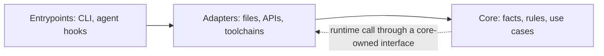
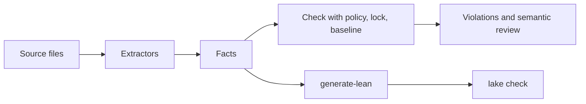

# Lintel

Lintel stops architecture rules from eroding while humans and AI agents edit a codebase. It turns those rules into facts a program can check, runs the same check in hooks and CI, and requires a recorded decision for exceptions.

## Why

Generated edits are fast and local. An agent can add an import that works, passes tests, and still moves outside code into the center of the app:

```python
# core/pricing.py
from adapters.config import load_config  # core now depends on the outside world
```

Tests still pass, but the change cost grows: core can no longer be reasoned about without the config stack, and later agents copy the pattern.

The inward rule prevents this. Put facts, rules, and use cases in **core**. Put files, processes, HTTP, databases, frameworks, and CLI handling in **adapters**. Let **entrypoints** wire them together. Dependencies point inward: entrypoints and adapters may use core; core does not import them. When core needs I/O, it calls an interface it owns, and an adapter implements it.

Lintel makes that rule enforceable. It extracts source facts, checks them against a readable policy, separates new violations from recorded debt, and sends ambiguous cases to explicit semantic review. Hooks catch drift at edit time, `lintel check` gives the same result locally and in CI, `lintel.lock` catches silent rule changes, and every accepted exception carries a stable ID and a reason. A Lean model proves the deterministic part of the check over the extracted facts.

If you know Clean, Hexagonal, or Onion architecture, this is their shared dependency rule; they differ mainly in vocabulary. [docs/philosophy.md](docs/philosophy.md) compares them.



Solid arrows show source dependencies. The dashed arrow shows a call through an interface, not a source import.

For agents, that turns "keep the architecture clean" into concrete commands and machine-readable findings. Architecture intent survives long sequences of autonomous edits.

## Formal Lean spec

`lintel/Lintel.lean` is a Lean 4 model of inward dependency boundaries. It proves deterministic properties over extracted facts; `generate-lean` instantiates those facts and checks the generated module with Lean.

The theorem catalog, model definitions, and generation details are in [docs/formal-spec.md](docs/formal-spec.md).

Trust boundary: generated Lean proves deterministic fact/policy checks only. Extraction completeness, runtime behavior, semantic judgment, typed capability choices, strict layering, and runtime/nested subsystem embeddings are not claimed as Lean theorems. `generatedNestedArchitecture` is an identity-embedding sanity instance, not a claim about repository subsystems. Scope coverage includes all scoped paths, including documentation and configuration files, not only source modules. See [docs/limitations.md](docs/limitations.md).

Toolchain: Lean 4.36.0, pinned in `lintel/lean-toolchain`.

Requires `lake` on `PATH`. Verify with:

```sh
cd lintel && lake build
```

CI runs both `lake build` and the Python checker pipeline on pushes and pull requests.

## Extractors and checker

`lintel/cli/extract_*.py` are CLI entrypoints. They call the extractor libraries in `lintel/adapters/*_extractor.py`, which scan a project root and emit JSON facts:



- `modules`: `{name, path, package?}` entries.
- `dependencies`: `{from, to, kind, source, line}` entries.

| Finding | Meaning |
| --- | --- |
| `core_outward` | A core module depends on a non-core module. |
| `forbidden_import` | A core module imports a forbidden target. |
| `edge_not_allowed` | A source region has no permission for the target region. |
| `cycle` | A module dependency cycle. |
| `unparsed_source` | Declared source could not be parsed or has no analyzer. |
| `semantic_review` | Detectable ambiguity needs a judge or human review. |

| Concept | Configuration | Role |
| --- | --- | --- |
| Layers | `[layers.*]` | Inward rings; shell-style `fnmatch`, sorted by `priority`, first match wins. `core = true` maps to `Core` in the Lean model. |
| Default layer | `default_layer` | Unowned fallback for dependencies with no matching layer. |
| Scopes | `[scopes.*]` | Test, example, fixture, generated, and vendor contexts—not architectural layers. |
| Executables | `[[executables]]` | CLI surfaces with an owning layer. |
| Source suffixes | `[analysis] source_suffixes` | Governed source files; undeclared or unsupported suffixes fail closed. |

`ports` and `core` are core; `platform` covers language runtime primitives; `entrypoints`, `adapters`, and `infrastructure` are outer rings. Ports are contracts and boundary data owned by core. `tests/fixtures/policy.json` is an example JSON policy covering Rust, Go, and TypeScript module names.

Exception rules are formalized in [ESCAPE_HATCHES.md](ESCAPE_HATCHES.md). See [Deterministic vs semantic findings](#deterministic-vs-semantic-findings) for examples, [Semantic scenarios and decision model](#semantic-scenarios-and-decision-model) for the overview, [SEMANTIC_SCENARIOS.md](SEMANTIC_SCENARIOS.md) for the detailed catalog, [docs/semantic-decisions.md](docs/semantic-decisions.md) for the model contract, and [docs/limitations.md](docs/limitations.md) for current status.


## Deterministic vs semantic findings

Lintel asks two different questions. Deterministic checks settle the question from source syntax: does `core` import an adapter, is a symbol a known CLI parser, is this import forbidden? Semantic checks handle valid syntax whose intent cannot be proved from the available facts: was an alias rebound, is an unknown decorator parsing argv, does a macro body call a boundary API when expanded? Both produce findings, but only deterministic findings can be decided without judgment.

A deterministic violation needs no interpretation:

```python
# core/pricing.py
from adapters.config import load_config  # core now depends on the outside world
```

The module is in `core`, the target is in `adapters`, and the policy forbids that direction. Result: `core_outward`.

The same boundary-shaped use can be ambiguous:

```python
# adapters/sample.py
import os as s
s = factory()       # s is rebound from an unknown expression
value = s.environ
```

`s` started as `os`, but `factory()` could return anything. Calling this `os.environ` would be a guess; staying silent could hide an environment leak. Result: one `semantic_review` with reason `unresolved alias 's' may expose boundary state`.

CLI and macro cases follow the same split:

```python
import click

@click.command()
def run(): ...
```

is a deterministic `argv_parse` finding, while `@app.group()` from an undeclared framework gets a bounded review. A real `println!` is deterministic `terminal_io`; a `println!` inside a `macro_rules!` body is reviewed at the definition, because expansion is not part of the fact set.

Why a decision model: generated code routinely has rebound aliases, wrapper decorators, and macro-hidden calls. A model can read the bounded finding, policy, and facts and propose `compliant`, `violating`, or `needs-human-review` with confidence and evidence. It cannot edit source, config, policy, or the lock. Proposals stay advisory until `lintel review` records a human decision; uncertainty fails closed and the finding remains visible.

That pipeline is described next in [Semantic scenarios and decision model](#semantic-scenarios-and-decision-model).

## Semantic scenarios and decision model

Default `lintel check` runs deterministic checks plus the semantic/model stage
and emits proposed decisions. Proposals are advisory: a `compliant` proposal
does not suppress a finding until `lintel review` accepts it; `violating` and
`needs-human-review` keep the finding visible. Hooks and CI use
`lintel check --stages deterministic` so they need no API key or network call.
Uncertainty fails closed, and the model cannot edit source, config, policy, or
the lock.

```toml
[semantic_decision]
model = "liquid/d1.2"
endpoint = "https://openrouter.ai/api/alpha/decisions"
api_key_env = "OPENROUTER_API_KEY"
answer_key = "decision"
min_confidence = 0.85
timeout = 20
max_findings = 64
```

The config stores only the environment-variable name, not the key. Changing
the `[semantic_decision]` table requires `lintel update-lock`.

```sh
lintel check
lintel check --stages deterministic
lintel review <fingerprint> --decision compliant|violating|needs-human-review --reason <reason>
```

`lintel review` is the only command that commits an accepted exception and
updates `lintel.lock`.

### Install and usage

Requires Python 3.11+. Install from this source checkout:

```sh
python3 -m venv .venv
. .venv/bin/activate
python -m pip install .
```

Quickstart:

```sh
lintel init --preset clean --output /path/to/new-project  # new projects only
lintel check
lintel check --out facts.json
lintel check facts.json --config lintel.toml
lintel generate-lean --facts facts.json
```

`--root` defaults to the current directory; set it only when running elsewhere.

Full command reference, native extractors, lock/cache behavior, and implementation layout are in [docs/usage.md](docs/usage.md). Wire generated hooks into a harness with [HARNESS_SETUP.md](HARNESS_SETUP.md). The installed CLI uses dependency-free Python analyzers by default.

## Agent and harness integration

`lintel init` writes short `AGENTS.md`, procedural `SKILL.md`, and fallback `HARNESS_SETUP.md` files into the scaffolded project. They describe the same deterministic workflow without importing any harness SDK.

Every harness calls one command:

```sh
lintel hook <session-start|post-edit|stop|review-request>
```

| Hook | Purpose | `block` |
| --- | --- | --- |
| `session-start` | Seed the agent with the inward-dependency rule. | No |
| `post-edit` | Check after each edit. | Yes when findings remain |
| `stop` | Final check before completion. | Yes when findings remain |
| `review-request` | List available semantic review decisions. | No |

It prints JSON with `block`, `context`, `findings`, and `commands`. Findings carry stable fingerprints. `HARNESS_SETUP.md` shows hook wiring for Claude Code, OpenCode, Pi, and a generic shell fallback.

Semantic decisions are explicit:

```sh
lintel review <fingerprint> --decision compliant --reason "port is intentionally typed"
```

| Decision | Effect |
| --- | --- |
| `compliant` | Accepts the finding and records its source for generated Lean. |
| `violating` | Leaves the finding pending. |
| `needs-human-review` | Leaves the finding pending. |

Every decision requires a reason and updates the baseline and lock through a reviewable diff.

Dogfooding: `python3 lintel/cli/check_self.py` parses CLI arguments, builds the runtime adapter, and calls the self-check use case. The use case asks ports for config, facts, and checking; `lintel/adapters/runtime.py` performs extraction, merging, and file I/O behind those ports. Fixtures under `tests/fixtures/` are excluded because they deliberately contain violations. The check needs Python, Rust, and Go toolchains; the TypeScript source is scanned by the Python scanner.
Dogfood configuration and policy live in `lintel.toml` at the repo root:

```toml
version = 1
default_layer = "external"
default_scope = "external"

[paths]
core_root = "lintel/core"
adapters_root = "lintel/adapters"
entrypoints_root = "lintel/cli"

[[executables]]
name = "check_self"
path = "lintel/cli/check_self.py"
owner = "entrypoints"

[layers.core]
priority = 20
core = true
patterns = ["lintel.core.*"]
allowed = ["ports", "core", "platform"]
```

CLI flags override path values. Layer patterns and allowed edges are independent of folder names, but executable surfaces are declared explicitly in `[[executables]]`.

Limits are summarized here; the status catalog is [docs/limitations.md](docs/limitations.md). Unsupported syntax fails closed as `unparsed_source`, ambiguous cases produce `semantic_review`, and native extractors extend coverage where toolchains exist. Exception mechanisms are in [ESCAPE_HATCHES.md](ESCAPE_HATCHES.md); ambiguity cases are in [SEMANTIC_SCENARIOS.md](SEMANTIC_SCENARIOS.md).

The fixtures under `tests/fixtures/` contain deliberate violations and are useful for smoke-testing the pipeline.
