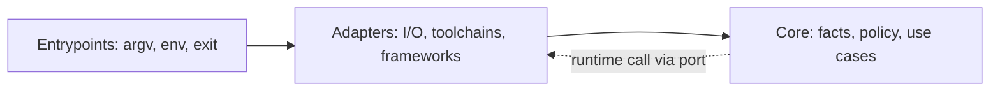
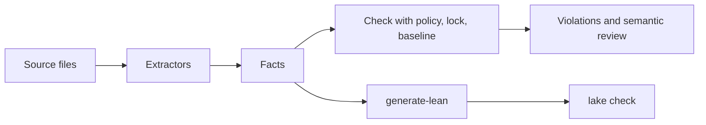

# Lintel

Lintel checks and governs inward architecture boundaries for agentic codebases. It provides deterministic checks, a Lean formalization, and harness-neutral hook and review commands.

## Why

Clean, Hexagonal, Onion, and related architectures are variants of one idea: keep business logic at the center and push frameworks, I/O, UI, and persistence to the edge. They differ in vocabulary—ports and adapters, rings, layers—but share the same dependency rule: source dependencies point inward, the core defines contracts, outer code implements them, and the application can be exercised without infrastructure.



Solid arrows show source dependencies; the dashed arrow shows a runtime call through a port. Adapters still depend inward on core-owned contracts.

That discipline is easy to state and hard to keep, especially in agentic codebases where many edits are generated quickly and conventions are learned from examples. Lintel turns the shared rule into machine-checkable architecture facts, a decidable policy, a formal Lean model, and a review workflow for cases that cannot be decided statically. It separates new violations from existing debt and requires explicit, fingerprinted decisions for semantic exceptions.

For agents, this makes the boundary contract visible at edit time: hooks report violations, `lintel check` gives the same answer everywhere, `lintel.lock` prevents silent rule changes, and semantic review records why an exception was accepted. The result is architecture intent that survives long sequences of autonomous edits.

The detailed comparison and primary-source notes are in [docs/philosophy.md](docs/philosophy.md).

## Formal Lean spec

`lintel/Lintel.lean` is a Lean 4 model of inward dependency boundaries. It proves deterministic properties over extracted facts; `generate-lean` instantiates those facts and checks the generated module with Lean.

The theorem catalog, model definitions, and generation details are in [docs/formal-spec.md](docs/formal-spec.md).

Trust boundary: generated Lean proves deterministic fact/policy checks only. Extraction completeness, runtime behavior, semantic judgment, typed capability choices, strict layering, and runtime/nested subsystem embeddings are not claimed as Lean theorems. `generatedNestedArchitecture` is an identity-embedding sanity instance, not a claim about repository subsystems. Scope coverage includes all scoped paths, including documentation and configuration files, not only source modules. See [docs/limitations.md](docs/limitations.md).

Toolchain: Lean 4.36.0, pinned in `lintel/lean-toolchain`.

Requires `lake` on `PATH`. Verify with:

```sh
cd lintel && lake build
```

CI runs both `lake build` and the Python checker pipeline on pushes and pull requests.

## Extractors and checker

`lintel/cli/extract_*.py` are CLI entrypoints. They call the extractor libraries in `lintel/adapters/*_extractor.py`, which scan a project root and emit JSON facts:



- `modules`: `{name, path, package?}` entries.
- `dependencies`: `{from, to, kind, source, line}` entries.

| Finding | Meaning |
| --- | --- |
| `core_outward` | A core module depends on a non-core module. |
| `forbidden_import` | A core module imports a forbidden target. |
| `edge_not_allowed` | A source region has no permission for the target region. |
| `cycle` | A module dependency cycle. |
| `unparsed_source` | Declared source could not be parsed or has no analyzer. |
| `semantic_review` | Detectable ambiguity needs a judge or human review. |

| Concept | Configuration | Role |
| --- | --- | --- |
| Layers | `[layers.*]` | Inward rings; shell-style `fnmatch`, sorted by `priority`, first match wins. `core = true` maps to `Core` in the Lean model. |
| Default layer | `default_layer` | Unowned fallback for dependencies with no matching layer. |
| Scopes | `[scopes.*]` | Test, example, fixture, generated, and vendor contexts—not architectural layers. |
| Executables | `[[executables]]` | CLI surfaces with an owning layer. |
| Source suffixes | `[analysis] source_suffixes` | Governed source files; undeclared or unsupported suffixes fail closed. |

`ports` and `core` are core; `platform` covers language runtime primitives; `entrypoints`, `adapters`, and `infrastructure` are outer rings. Ports are contracts and boundary data owned by core. `tests/fixtures/policy.json` is an example JSON policy covering Rust, Go, and TypeScript module names.

Exception rules are formalized in [ESCAPE_HATCHES.md](ESCAPE_HATCHES.md); semantic ambiguity scenarios are listed in [SEMANTIC_SCENARIOS.md](SEMANTIC_SCENARIOS.md).

### Install and usage

Requires Python 3.11+. Install from this source checkout:

```sh
python3 -m venv .venv
. .venv/bin/activate
python -m pip install .
```

Quickstart from the governed project directory:

```sh
lintel check
lintel check --out facts.json
lintel check facts.json --config lintel.toml
lintel generate-lean --facts facts.json
```

`--root` defaults to the current directory; set it only when running elsewhere. For a new project, run `lintel init --preset clean --output /path/to/new-project`.

Full command reference, native extractors, lock/cache behavior, and implementation layout are in [docs/usage.md](docs/usage.md). Wire generated hooks into a harness with [HARNESS_SETUP.md](HARNESS_SETUP.md). The installed CLI uses dependency-free Python analyzers by default.

## Agent and harness integration

`lintel init` writes short `AGENTS.md`, procedural `SKILL.md`, and fallback `HARNESS_SETUP.md` files into the scaffolded project. They describe the same deterministic workflow without importing any harness SDK.

Every harness calls one command:

```sh
lintel hook <session-start|post-edit|stop|review-request>
```

| Hook | Purpose | `block` |
| --- | --- | --- |
| `session-start` | Seed the agent with the inward-dependency rule. | No |
| `post-edit` | Check after each edit. | Yes when findings remain |
| `stop` | Final check before completion. | Yes when findings remain |
| `review-request` | List available semantic review decisions. | No |

It prints JSON with `block`, `context`, `findings`, and `commands`. Findings carry stable fingerprints. `HARNESS_SETUP.md` shows hook wiring for Claude Code, OpenCode, Pi, and a generic shell fallback.

Semantic decisions are explicit:

```sh
lintel review <fingerprint> --decision compliant --reason "port is intentionally typed"
```

| Decision | Effect |
| --- | --- |
| `compliant` | Accepts the finding and records its source for generated Lean. |
| `violating` | Leaves the finding pending. |
| `needs-human-review` | Leaves the finding pending. |

Every decision requires a reason and updates the baseline and lock through a reviewable diff.

Dogfooding: `python3 lintel/cli/check_self.py` parses CLI arguments, builds the runtime adapter, and calls the self-check use case. The use case asks ports for config, facts, and checking; `lintel/adapters/runtime.py` performs extraction, merging, and file I/O behind those ports. Fixtures under `tests/fixtures/` are excluded because they deliberately contain violations. The check needs Python, Rust, and Go toolchains; the TypeScript source is scanned by the Python scanner.
Dogfood configuration and policy live in `lintel.toml` at the repo root:

```toml
version = 1
default_layer = "external"
default_scope = "external"

[paths]
core_root = "lintel/core"
adapters_root = "lintel/adapters"
entrypoints_root = "lintel/cli"

[[executables]]
name = "check_self"
path = "lintel/cli/check_self.py"
owner = "entrypoints"

[layers.core]
priority = 20
core = true
patterns = ["lintel.core.*"]
allowed = ["ports", "core", "platform"]
```

CLI flags override path values. Layer patterns and allowed edges are independent of folder names, but executable surfaces are declared explicitly in `[[executables]]`.

Limits are summarized here; the status catalog is [docs/limitations.md](docs/limitations.md). Unsupported syntax fails closed as `unparsed_source`, ambiguous cases produce `semantic_review`, and native extractors extend coverage where toolchains exist. Exception mechanisms are in [ESCAPE_HATCHES.md](ESCAPE_HATCHES.md); ambiguity cases are in [SEMANTIC_SCENARIOS.md](SEMANTIC_SCENARIOS.md).

The fixtures under `tests/fixtures/` contain deliberate violations and are useful for smoke-testing the pipeline.
